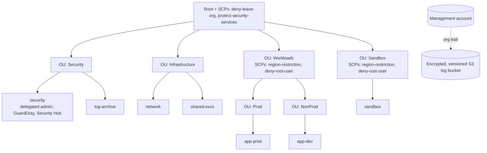

# aws-landing-zone-terraform

A compact, opinionated AWS landing zone built with Terraform: a multi-account AWS Organization with OU structure, Service Control Policy (SCP) guardrails, an organization-wide CloudTrail, and GuardDuty / Security Hub administration delegated to a dedicated security account.

This repo uses placeholder emails and names only. It is a reference implementation, not a copy of any employer's environment.

## Architecture



## What it deploys

| File | Purpose |
|------|---------|
| `organization.tf` | Organization, OU hierarchy, member accounts |
| `scps.tf` | Four SCPs and their attachments |
| `security.tf` | Org CloudTrail + hardened log bucket, GuardDuty and Security Hub delegated admin |
| `variables.tf` | Inputs, with validation on account OU names |

## Guardrails

- **deny-leave-org**: accounts cannot leave the organization.
- **protect-security-services**: CloudTrail, Config, GuardDuty and Security Hub cannot be switched off.
- **region-restriction**: workload and sandbox accounts are limited to approved regions (global services exempted).
- **deny-root-user**: no root-user actions in workload and sandbox accounts.

SCPs never apply to the management account, so keep it empty of workloads and protect it with MFA and tight IAM.

## Usage

```bash
cp terraform.tfvars.example terraform.tfvars   # edit emails and regions
cp backend.tf.example backend.tf               # remote state
terraform init
terraform plan
terraform apply
```

Run it with credentials for the management account. If an Organization already exists, import it first: `terraform import aws_organizations_organization.this <org-id>`.

## Design decisions

- **Plain Organizations resources instead of Control Tower**: every guardrail is visible and reviewable in code. Control Tower can be layered on later.
- **`for_each` everywhere**: adding an account or SCP is a data change, not a code change.
- **Defense in depth on logs**: versioning, encryption, public access block, TLS-only policy, and log file validation.
- **Account closure is not automatic**: `close_on_deletion = false` prevents a stray destroy from closing accounts.

## Known limitations and next steps

- GuardDuty and Security Hub member auto-enable must be configured from the security account (needs a provider alias that assumes `OrganizationAccountAccessRole`).
- Add AWS Config aggregation, IAM Identity Center permission sets, and an account-baseline module.
- Deploy through CI using GitHub OIDC (see the companion repo, `github-actions-oidc-aws`).

## CI

Every pull request runs `terraform fmt`, `validate`, TFLint and a Trivy config scan.

## License

MIT
